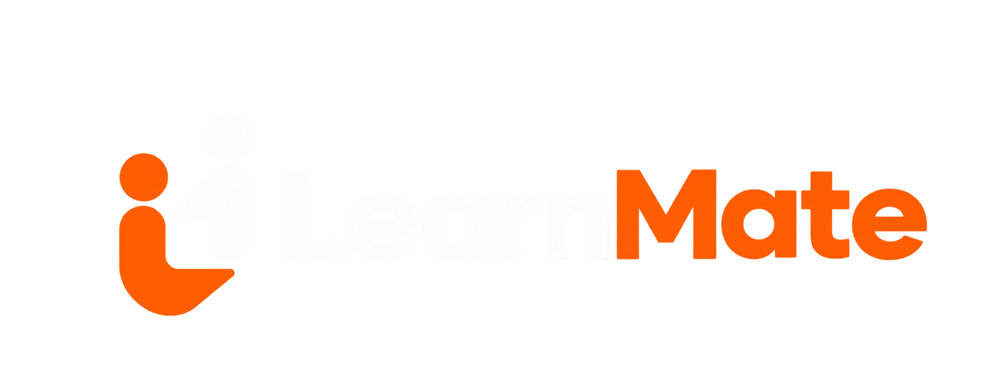

 

  

<h1 align="center">LearnMate</h1>

  <strong>Learn Together. Grow Together.</strong>
   
  Find compatible study partners, build meaningful connections, and make learning a collaborative experience.

  
  
  
  
  
  

---

## 🎓 About LearnMate

**LearnMate** is a collaborative learning platform designed to help students discover compatible study partners based on their learning interests, goals, skill levels, availability, and timezones.

Learning doesn't have to be a solo journey. LearnMate makes it easier to connect with like-minded students, share knowledge, exchange ideas, and build productive learning relationships.

Whether you're exploring programming, developing technical skills, or working toward academic goals, LearnMate helps you find the right people to learn with.

## ✨ Features

### 🔐 Authentication & Onboarding
- Secure email and password registration.
- User login and session management.
- Guided multi-step registration experience.
- Personalized profile setup during onboarding.
- Protected routes for authenticated users.
- Forgot password and password recovery functionality.

### 👤 Personalized Learning Profiles
- Create and customize personal learning profiles.
- Add learning interests and preferred topics.
- Select your current skill level.
- Set preferred learning availability.
- Configure your timezone.
- Add a personal biography.
- Generate and customize profile avatars.
- Update personal information and learning preferences.

### 🤝 Smart Study Partner Discovery
- Discover students with similar learning interests.
- Personalized study partner recommendations.
- Compatibility-based matching.
- Explore student profiles and learning preferences.
- Identify shared learning topics.
- Like potential study partners.
- Discover new students through the matching interface.

### 💚 Mutual Matching System
- Connect with students who share your interest.
- Mutual-like functionality.
- Automatic match creation when two students like each other.
- View your established learning connections.
- Explore matched student profiles.
- Access conversations with your learning partners.

### 💬 Real-Time Messaging
- Private conversations between matched students.
- Real-time message updates.
- Conversation history.
- Paginated message loading.
- Search conversations by user name.
- Message timestamps.
- Dedicated chat interface.
- Direct access to individual conversations.

### 🔔 Notifications
- Notifications for incoming likes.
- Notifications when a mutual match is established.
- New message notifications.
- Real-time notification updates.
- Unread notification indicators.
- Notification history.
- Mark notifications as read.

### 📊 Personalized Dashboard
- Personalized welcome experience.
- Overview of your learning profile.
- Display of learning level and availability.
- Overview of connected learning partners.
- Quick access to study partner discovery.
- Easy navigation to your existing connections.

### ⚙️ Profile & Account Management
- Dedicated profile management.
- Edit personal information.
- Update learning interests and preferences.
- Manage profile details.
- Dedicated account settings interface.

### 🎨 Modern User Experience
- Clean and intuitive interface.
- Responsive desktop and mobile layouts.
- Smooth animations and transitions.
- Interactive UI components.
- Custom profile avatars.
- Loading states and skeleton screens.
- Toast notifications and user feedback.
- Consistent navigation experience.

---

## 🚀 Coming Soon

### 💻 Coding Playground

LearnMate is expanding beyond study partner discovery and messaging to provide students with an interactive coding experience.

The upcoming **Coding Playground** will introduce:

- Interactive in-browser code editor.
- Syntax highlighting.
- Support for multiple programming languages.
- Integrated code execution.
- Programming practice exercises.
- Collaborative coding sessions with study partners.

Currently planned for a future release.

---

## 🛠️ Tech Stack

| Technology | Purpose |
|---|---|
| React 19 | Frontend development |
| TypeScript | Type safety |
| Vite | Development and build tooling |
| Tailwind CSS 4 | Styling |
| Redux Toolkit | State management |
| React Router | Application routing |
| Appwrite | Backend and database |
| Appwrite Authentication | User authentication |
| Appwrite Realtime | Real-time updates |
| React Hook Form | Form management |
| Radix UI | Accessible UI components |
| Motion | Animations |
| Lucide React | Icons |

---

## 🔄 How It Works

1. **Create Your Account** — Sign up and complete the guided onboarding process.
2. **Build Your Profile** — Add your learning interests, skill level, availability, and timezone.
3. **Discover Study Partners** — Explore students with compatible learning interests and preferences.
4. **Make Connections** — Like students you'd like to learn with.
5. **Get Matched** — Connect automatically when another student likes you back.
6. **Start Learning Together** — Communicate through private real-time conversations.
7. **Stay Connected** — Receive notifications and keep your learning profile updated.

---

## 🎯 Our Vision

Our vision is to make learning more social, engaging, and accessible.

LearnMate aims to become a collaborative learning environment where students can discover study partners, exchange knowledge, communicate, practice programming, and grow together.

We believe that learning becomes more meaningful when shared with the right people.

**Find your people. Share your knowledge. Learn further.**

---

## 📜 License

This project is licensed under the **MIT License**.

You are free to use, copy, modify, merge, publish, distribute, sublicense, and/or sell copies of this software, subject to the conditions of the MIT License.

See the [LICENSE](./LICENSE) file for the full license text.

---

  <strong>Built with ❤️ for collaborative learning.</strong>
   
  LearnMate — Learn Together. Grow Together.

